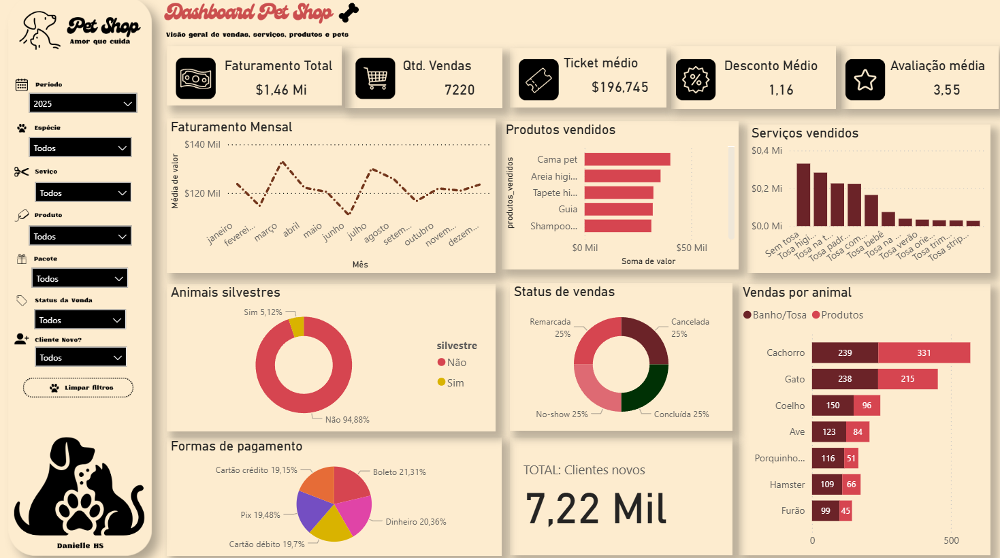
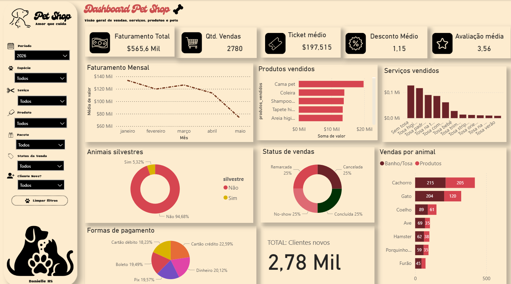

<h1 align="center">🐾 Análise de Vendas · Petshop</h1>

<p align="center">
  Quais serviços, produtos, pacotes e clientes sustentam o faturamento de um petshop,<br>
  e onde estão as oportunidades para vender mais e reter melhor.
</p>

<p align="center">
  
  
  
</p>

## Sobre o projeto

Um petshop quer entender seu desempenho comercial e operacional. A base tem **10.000 atendimentos** registrados entre janeiro de 2025 e maio de 2026, com dados de cliente, pet, serviço, pacote, produtos vendidos, desconto, pagamento, status e avaliação.

O projeto seguiu o caminho completo de uma análise:

1. **Respostas às perguntas de negócio em SQL**: 39 consultas organizadas em 9 temas.
2. **Dashboard em Power BI**, com filtros por período, espécie, serviço, produto, pacote, status e perfil do cliente.
3. **Análise executiva** com insights e recomendações práticas.

Este repositório reúne os prints do dashboard e a explicação da análise.

> **Pergunta central:** quais serviços, produtos, pacotes e perfis de clientes mais contribuem para o faturamento, e quais oportunidades existem para aumentar ticket médio, recompra e satisfação?

⚠️ Os dados são fictícios, criados para fins de estudo e portfólio.

## Dashboard

Desenvolvido no Power BI, o dashboard reúne a visão geral de vendas, serviços, produtos e pets em uma única página. Os prints abaixo mostram o mesmo painel filtrado por ano.

### Visão 2025



### Visão 2026 (janeiro a maio)



| Bloco | O que mostra |
|---|---|
| KPIs | Faturamento total, quantidade de vendas, ticket médio, desconto médio e avaliação média |
| Faturamento mensal | Evolução da receita mês a mês |
| Produtos vendidos | Produtos que mais geram receita junto com os serviços |
| Serviços vendidos | Faturamento por tipo de tosa e corte |
| Animais silvestres | Participação de pets silvestres nos atendimentos |
| Status de vendas | Vendas concluídas, remarcadas, canceladas e no-show |
| Vendas por animal | Receita de banho e tosa x produtos, por espécie |
| Formas de pagamento | Distribuição das vendas por meio de pagamento |
| Clientes novos | Volume de vendas para clientes novos |

**Filtros:** período · espécie · serviço · produto · pacote · status da venda · cliente novo ou recorrente · botão para limpar todos os filtros.

### O que muda entre os dois anos

| Indicador | 2025 | 2026 (jan–mai) |
|---|---|---|
| Faturamento | R$ 1,46 milhão | R$ 565,6 mil |
| Quantidade de vendas | 7.220 | 2.780 |
| Ticket médio | R$ 196,75 | R$ 197,52 |
| Avaliação média | 3,55 | 3,56 |
| Pets silvestres | 5,12% | 5,32% |

O ticket médio e a avaliação se mantêm estáveis de um ano para o outro. Em 2026, a cama pet segue como o produto que mais fatura, e a coleira sobe para o segundo lugar. No gráfico mensal de 2026, maio aparece mais baixo porque a base termina nesse mês.

## Principais números (base completa)

| Indicador | Resultado |
|---|---|
| Faturamento registrado | R$ 2,03 milhões |
| Faturamento realizado (vendas concluídas) | R$ 1,74 milhão |
| Total de vendas | 10.000 |
| Ticket médio | R$ 203,02 |
| Vendas não concluídas | 13,9% |
| Vendas com produto adicional | 62,2% |
| Vendas de clientes recorrentes | 72,8% |
| Vendas com desconto | 11,4% |
| Avaliação média | 3,55 de 5 |

## Principais insights

### 1. R$ 285 mil ficaram pelo caminho

Quase 1 em cada 7 atendimentos não foi concluído. Remarcações, no-show e cancelamentos aparecem em proporções parecidas. É a maior oportunidade de receita da base, porque o cliente já tinha decidido comprar.

### 2. Produto adicional é o caminho mais curto para o ticket médio

Vendas com produto têm ticket de **R$ 231**, contra **R$ 156** das vendas só de serviço (+48%). Cada item a mais soma cerca de R$ 43. Ainda assim, 38% dos atendimentos saem sem nenhum produto.

Os produtos vendem em volumes parecidos, mas o impacto no faturamento varia bastante. A cama pet gerou R$ 91 mil com 702 unidades. O laço/presilha vendeu mais (727 unidades) e gerou só R$ 9 mil.

### 3. Raças especiais lidera, e dois pacotes têm espaço para crescer

O pacote **Raças especiais** traz o maior faturamento (R$ 386 mil) e o maior ticket (R$ 307). O **Pacote mensal 4 banhos** e o **Pacote premium** vendem abaixo da média, mas têm ticket acima dela. O mensal ainda tem a melhor avaliação entre os pacotes (3,64) e estimula a recompra.

Pacotes com banho e tosa têm ticket 24% maior que os pacotes só de banho (R$ 219 contra R$ 176).

### 4. Faturamento estável, sem sazonalidade relevante

A receita mensal oscila entre R$ 111 mil (junho/2025) e R$ 134 mil (janeiro/2026). Quinta e sexta concentram um pouco mais de vendas, mas a diferença entre os dias da semana é pequena.

### 5. Outros achados

- **Banho premium** é o tipo de banho que mais fatura (R$ 608 mil), mesmo vendendo menos que o banho simples. O ticket é R$ 90 maior.
- **Cachorros** são 63% dos atendimentos. **Gatos** têm o maior ticket médio entre as espécies (R$ 221).
- **Pets silvestres** somam 5,2% dos atendimentos, com ticket parecido e avaliação um pouco menor (3,46 contra 3,56).
- **Clientes recorrentes** respondem por 73% das vendas. Os 25% que mais gastam geram 31,5% do faturamento.
- **Descontos** custaram R$ 11,6 mil, só 0,57% do faturamento bruto. Não há sinal de desconto excessivo.
- **Formas de pagamento** estão bem distribuídas, cerca de 20% cada. Cartão de crédito tem a maior taxa de cancelamento (5,1%).
- **Avaliação:** 17,7% das notas são 1 ou 2. A nota quase não muda com o valor da venda ou com as observações do atendimento, o que indica causas que a base ainda não registra.

## Recomendações

| Prioridade | Ação | Por quê |
|---|---|---|
| 1 | Confirmar o agendamento 24h antes e cobrar sinal em pacotes de maior valor | Recuperar parte dos R$ 285 mil em vendas não concluídas |
| 2 | Oferecer kits de produtos no fechamento do atendimento, com destaque para cama pet, tapete higiênico e peitoral | Cada produto adicional soma cerca de R$ 43 ao ticket |
| 3 | Fazer campanhas para o Pacote mensal 4 banhos e o Pacote premium | Ticket alto, boa avaliação e volume ainda abaixo da média |
| 4 | Oferecer upgrade do banho simples para o premium | O banho simples é o mais vendido, e o premium rende R$ 90 a mais por venda |
| 5 | Criar um programa de fidelidade para os 60 clientes que mais gastam | São 25% da base e geram quase um terço da receita |
| 6 | Registrar o motivo das notas baixas | 17,7% de notas 1 e 2 sem causa visível nos dados atuais |

## Próximas melhorias no dashboard

Este foi um dos meus primeiros dashboards analíticos. Revisando o painel junto com as consultas SQL, mapeei os ajustes da próxima versão:

- **Status de vendas:** corrigir a medida do gráfico, que hoje mostra 25% para cada status. O valor correto é 86,1% de vendas concluídas.
- **Clientes novos:** filtrar a medida por `cliente_novo = "Sim"`. Hoje o card repete o total de vendas.
- **Formato de moeda:** trocar `$` por `R$` e padronizar as casas decimais dos cards.
- **Faturamento realizado:** incluir um card só com as vendas concluídas, separado do faturamento registrado.
- **Medidas DAX dedicadas:** criar medidas para ticket médio, taxa de cancelamento e percentual de clientes novos, em vez de agregações automáticas.

## Base de dados

A planilha original tem cinco abas: Vendas_Petshop (10.000 linhas), Produtos (15), Pacotes (8), Dicionário e Resumo.

| Campo | Descrição |
|---|---|
| `id_venda` | Identificador do atendimento |
| `data_venda` | Data do atendimento |
| `nome_dono`, `nome_pet` | Cliente e pet atendido |
| `especie`, `raca`, `silvestre` | Perfil do pet |
| `cliente_novo` | Indica se foi a primeira compra do cliente |
| `tipo_banho`, `tipo_tosa`, `pacote_corte_tosa` | Serviço e pacote contratados |
| `id_produtos_vendidos`, `produtos_vendidos`, `qtd_produtos` | Produtos vendidos no atendimento |
| `valor_servico`, `valor_produtos`, `desconto`, `valor_total` | Valores em R$ (total = serviço + produtos − desconto) |
| `forma_pagamento`, `status_venda` | Pagamento e situação da venda |
| `avaliacao` | Nota de 1 a 5; em branco quando o cliente não avaliou |
| `observacao` | Observação registrada no atendimento |

**Tratamento aplicado:** os produtos de cada venda vêm juntos em um único campo (`1011;1012;1009`). Em Python, separei esses IDs e criei a tabela `venda_produtos`, com uma linha por produto vendido. Isso permitiu analisar produtos e combinações em SQL.

## Perguntas de negócio respondidas em SQL

| Tema | Exemplos de perguntas |
|---|---|
| Visão geral | Faturamento, ticket médio, status das vendas, sazonalidade |
| Banho, tosa e cortes | Faturamento por banho, top 10 cortes, cancelamento por serviço |
| Produtos | Mais vendidos, receita adicional, combinações frequentes |
| Perfil dos pets | Espécies, raças, pets silvestres |
| Perfil dos clientes | Novos x recorrentes, top clientes, segmentação por gasto |
| Pacotes | Desempenho por pacote, banho + tosa x só banho |
| Descontos | Impacto no faturamento, desconto por perfil e pagamento |
| Pagamentos | Uso, ticket e cancelamento por forma de pagamento |
| Satisfação | Distribuição das notas, avaliação por valor e status |

As consultas usam `GROUP BY`, `CASE WHEN`, `JOIN`, CTEs (`WITH`) e funções de janela (`OVER`, `ROW_NUMBER`, `NTILE`).

**Exemplo:** pares de produtos que mais aparecem juntos na mesma venda.

```sql
SELECT
    pa.produto AS produto_a,
    pb.produto AS produto_b,
    COUNT(*)   AS vendas_juntos
FROM venda_produtos a
JOIN venda_produtos b ON a.id_venda = b.id_venda AND a.id_produto < b.id_produto
JOIN produtos pa ON pa.id_produto = a.id_produto
JOIN produtos pb ON pb.id_produto = b.id_produto
GROUP BY produto_a, produto_b
ORDER BY vendas_juntos DESC
LIMIT 10;
```

## Estrutura do repositório

```
analise-vendas-petshop/
├── images/      # Prints do dashboard (2025 e 2026)
└── README.md    # Explicação da análise, insights e recomendações
```

## Ferramentas

- **Power BI** (Power Query, DAX e modelagem): dashboard interativo
- **SQL** (SQLite): respostas às perguntas de negócio
- **DAX** (Modelagem): Modelagem de dados 
- **Excel**: base original

## Autora

**Danielle Honório Stevam** · Analista de Dados Jr

[GitHub](https://github.com/danielleh5)
